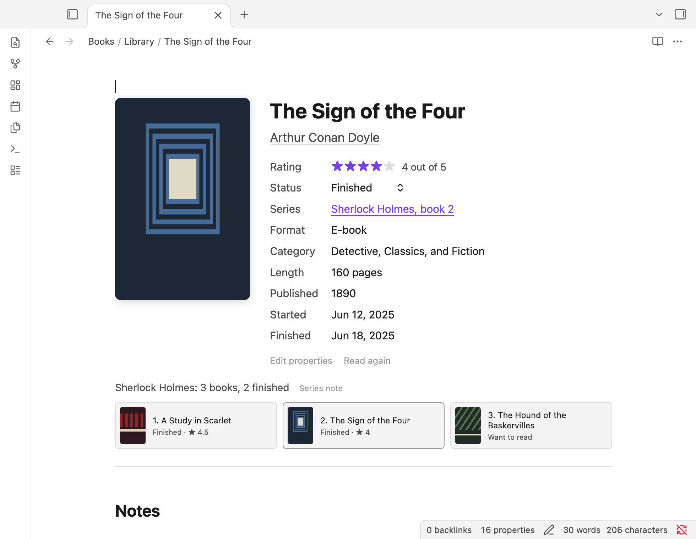
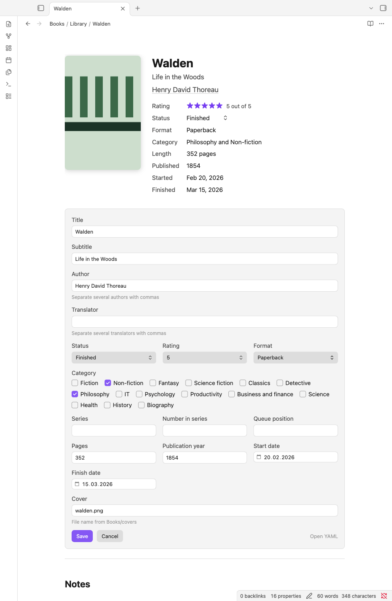
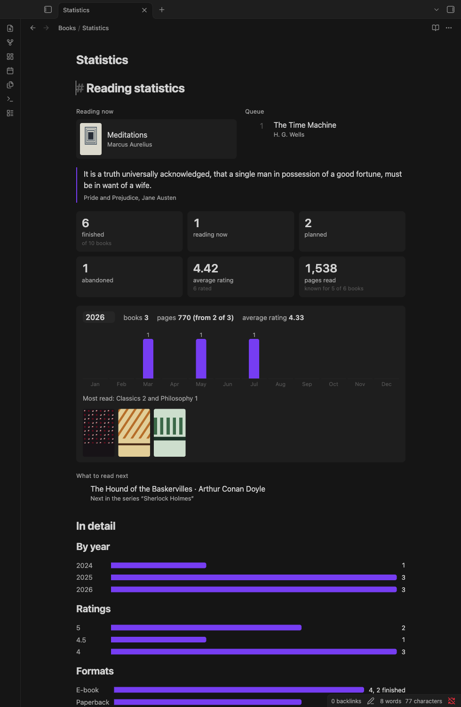

<p align="center">
  
</p>

<h1 align="center">Colophon</h1>

<p align="center">
  <a href="LICENSE"></a>
  <a href="https://github.com/0then0/colophon/actions/workflows/ci.yml"></a>
  <a href="https://github.com/0then0/colophon/releases"></a>
  <a href="#languages"></a>
</p>

Colophon is a book library and reading journal for [Obsidian](https://obsidian.md). One note per book, plain
Markdown with Properties, and a few scripts that turn those notes into a book page, a library, a reading queue and
statistics. Your data stays in your notes. Without Colophon they are still ordinary notes.

Colophon is an independent project. It is not affiliated with Obsidian or endorsed by Obsidian.

## Contents

- [Screenshots](#screenshots)
- [What it does](#what-it-does)
- [Requirements](#requirements)
- [Quick start](#quick-start)
- [Documentation](#documentation)
- [Languages](#languages)
- [Compatibility and limitations](#compatibility-and-limitations)
- [Contributing](#contributing)
- [License](#license)

## Screenshots

Screenshots use the example vault (public domain books, generated placeholder covers) in Obsidian 1.15.0 on macOS,
with the English interface.







## What it does

- **Book page.** Cover, title, authors, series, format, category, dates and a rating in half-star steps. Status,
  rating and queue position change in place, and a form edits every property. Everything is written back to the note's
  Properties.
- **Author and series panels.** Click an author or a series to see their other books in your library.
- **Reading queue.** Mark a planned book with "Add to queue"; the queue is ordered and shows up in statistics and in the
  Library base.
- **Read again.** Starts a new read, keeps the previous dates in a "Reading history" section and counts each read in
  its own year in the statistics.
- **Reading time.** The book page shows how many days a read took, or how long a book has been in progress.
- **Statistics.** Books and pages per year and month, average rating, formats, genres, series progress, most-read
  authors, reading time, rereads, a quote from your own notes, and suggestions for what to read next based on your
  ratings. Every suggestion shows its reason. Every number is clickable and opens the list of its books under it (cards
  at the top, months, topics, and the bars of the detailed breakdowns).
- **What to read next.** Three fiction and three non-fiction books from your plans, at most one per author and two per
  topic. Averages of authors and topics are smoothed while there are few books; an abandoned book counts against its
  author and topic; a series you dropped is not suggested; a link in your notes to a book you rated 4 or more is a
  reason; a book that waited for years gets a small bonus. "Continue a series" is a block of its own. One place in each
  half rotates once a month ("Pick of the month"). Filters (all, fiction, non-fiction, up to 300 pages, audio) appear
  when a book matches. "Add to queue" puts a book at the end of the queue; "Not now" hides it for three months through
  the property `snoozed_until`. Delete the property to bring the book back.
- **Library base.** A Bases file with table and card views: all books, queue, series, reading, want to read, finished,
  abandoned, top rated, audiobooks and one view for each category.
- **Prequels.** Number 0 in a series marks a prequel. It is named in the series panel and the Series view, it sorts
  first, and it never holds back the main books in "Continue a series" and the suggestions.
- **Summaries.** Notes with `type: summary` (see [Summaries](docs/NOTES.md#summaries)) keep ideas from books you do not read in full
  apart from the library and the statistics.
- **StoryGraph import inside Obsidian.** Choose the exported CSV on the Import page, check the preview and confirm.
  The same import also runs from a terminal, and Goodreads exports are imported from a terminal.
- **Seven interface languages**, chosen from the Obsidian language or from a setting.
- **A cover script** that shrinks oversized JPEG covers and keeps the originals.

## Requirements

- **Obsidian 1.9.10 or newer.** The Library is a Bases file, and Bases became available to everyone in 1.9.10
  ([official changelog](https://obsidian.md/changelog/2025-08-18-desktop-v1.9.10/)).
- **[Dataview](https://github.com/blacksmithgu/obsidian-dataview)** with **Enable JavaScript Queries** turned on.
- The core **Templates** plugin, if you want to create books from the template.

Colophon itself has no other dependencies. Some optional tools need more:

- the installer and the command-line importers need [Node.js](https://nodejs.org) 20 or newer (no `npm install`);
- the cover script needs Python 3.11 or newer and Pillow.

Without Node you can install Colophon by hand and import a StoryGraph library inside Obsidian.

## Quick start

1. Download `colophon-<version>.zip` from the [releases page](https://github.com/0then0/colophon/releases) and unpack
   it.
2. In the unpacked folder, run the installer with the path of your vault. The first command only prints a plan, the
   second one installs:

   ```bash
   node install.mjs "/path/to/your/vault"
   node install.mjs "/path/to/your/vault" --apply --language en
   ```

   The installer never overwrites a changed file without `--force`, never deletes anything and never touches your
   `.obsidian` folder. Try it on a copy of your vault first.
3. In Obsidian, install and enable the **Dataview** community plugin and turn on **Enable JavaScript Queries** in its
   settings. Enable the core **Templates** plugin and set its template folder to `Templates`.
4. Add books:
   - create a note in `Books/Library`, run **Templates: Insert template** and choose `Book`; or
   - open `Books/Import` and import a StoryGraph export.
5. Open `Books/Statistics` and `Books/Library.base`.

All installer options, the installation by hand (no Node needed) and updating are described in
[docs/INSTALL.md](docs/INSTALL.md).

To look before you install, open the [`example-vault`](example-vault) folder of this repository as a vault. Obsidian
asks whether you trust the vault; after that, install Dataview from the Community plugins browser (plugin files are not
stored in the repository; JavaScript queries are already turned on in the vault's settings).

## Documentation

| Document | What is in it |
| --- | --- |
| [docs/INSTALL.md](docs/INSTALL.md) | Installer options, installation by hand, updating, checking the download |
| [docs/SETTINGS.md](docs/SETTINGS.md) | `Colophon/config.json`: language, folders, your own statuses, formats and categories |
| [docs/NOTES.md](docs/NOTES.md) | Properties of a book note, reading history, reading time, the template, summaries |
| [docs/IMPORT.md](docs/IMPORT.md) | Importing from StoryGraph and Goodreads, covers and the cover script |
| [CHANGELOG.md](CHANGELOG.md) | What changed in each release |
| [CONTRIBUTING.md](CONTRIBUTING.md) | Project layout, checks, adding a language, building a release |
| [SECURITY.md](SECURITY.md) | Reporting a vulnerability and using Colophon safely |

## Languages

| Code    | Language           |
| ------- | ------------------ |
| `en`    | English (source)   |
| `ru`    | Русский            |
| `es`    | Español            |
| `de`    | Deutsch            |
| `fr`    | Français           |
| `ja`    | 日本語             |
| `pt-BR` | Português (Brasil) |

All interface text is in [`Colophon/locales/`](example-vault/Colophon/locales). Missing keys fall back to English. Plurals,
numbers, dates and lists use the browser's `Intl`, so Russian has its four plural forms and dates follow the language.

## Compatibility and limitations

**Tested.** Obsidian 1.15.0 on macOS with Dataview 0.5.70 (the import page with Dataview 0.5.68). The book page, edit
form, panels, statistics and Library base were checked in a 375 px wide desktop window, in all seven languages, in the
light and dark default themes and with the themes Minimal, Things, Blue Topaz and AnuPpuccin. The import page was
checked in the default themes, in a narrow layout, in English and Russian.

**Not tested.** Windows, Linux, iOS and Android; touch behaviour and Obsidian Mobile; Obsidian versions older than
1.15.0. Version 1.9.10 is the minimum because of Bases, not a version Colophon was run on.

**Performance.** With 5000 synthetic book notes (Obsidian 1.15.0, macOS) the statistics page draws in about 0.2 s, the
book page opens in about 60 ms and an author or series panel in under 60 ms. When a note changes, Dataview refreshes
an open statistics page after its own refresh interval (2.5 s by default). Larger libraries and slower machines were
not measured.

**Known limitations.**

- DataviewJS runs code from your vault. Enable it only in vaults you trust; see [SECURITY.md](SECURITY.md).
- A `.base` file cannot load translations at run time, so the view names, column names and status labels of the
  Library are fixed text. The files are generated per language (`Colophon/localized/Library.<code>.base`); changing the
  Obsidian language later does not change an installed base. The template, the statistics note and the import page are
  generated per language for the same reason. Filters and sorting use the stable English keys, so every language shows
  the same books.
- The "Reading history" heading is not translated, because the statistics parse it.
- Dates in the edit form use your system's date picker, not the Colophon language.
- Imports only create new notes: existing notes are not updated or merged, and covers are not downloaded.
- The cover script handles JPEG files only.

## Contributing

Bug reports, wording fixes and translations are welcome. Read [CONTRIBUTING.md](CONTRIBUTING.md) and the
[Code of Conduct](CODE_OF_CONDUCT.md). Security problems go through [SECURITY.md](SECURITY.md).

## License

[Apache-2.0](LICENSE). The example vault contains only metadata of public domain books, quotations from public domain
texts and covers generated by `tools/dev/generate-demo-covers.py`.
